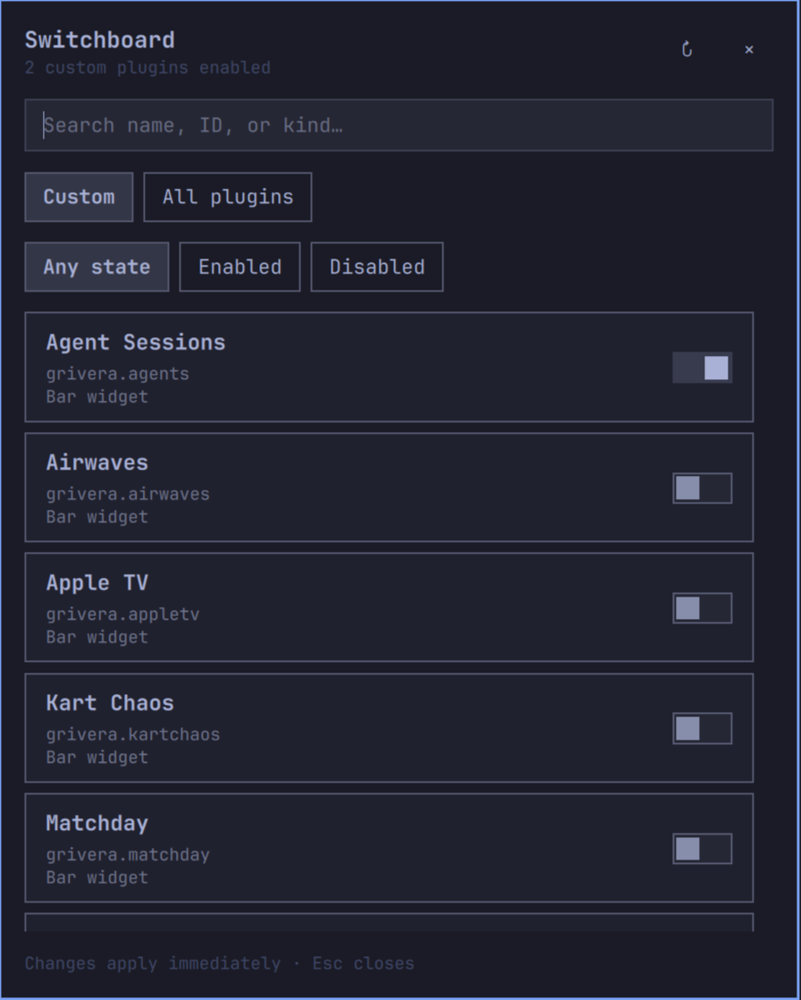

# Switchboard

[](LICENSE) [](https://plugins.omarchy.org/plugin.html?id=grivera.switchboard)

> Part of the [Omarchy plugin marketplace](https://plugins.omarchy.org/plugin.html?id=grivera.switchboard), listed as **Switchboard** (plugin ID `grivera.switchboard`). The marketplace registry lives at [omacom/omarchy-plugin-marketplace](https://github.com/omacom/omarchy-plugin-marketplace).

Keep your Omarchy bar tidy with a searchable plugin manager behind one icon.
Enable or disable installed plugins without closing the menu, and bring widgets
back with their settings and placement intact.



## Features

- Search by plugin name, ID, or kind.
- Browse custom plugins or all installed plugins.
- Filter by enabled or disabled state.
- Toggle plugins immediately, with errors shown in the menu.
- Keep the menu, search, filters, and scroll position through bar rebuilds.
- Remember widget settings and nearby placement for toggles made in Switchboard.
- Match the current Omarchy theme.

## Requirements

Omarchy 4 with `omarchy-shell`, Python 3, and the `omarchy` CLI. Tested on
Omarchy 4.0.4. No extra Python packages are required. The plugin does not make
background network requests.

## Install

```bash
omarchy plugin add https://github.com/grivera82/omarchy-plugin-switchboard.git --enable
```

Click the gear icon in the bar, or open the menu from a terminal:

```bash
omarchy-shell grivera.switchboard toggle
```

Search takes focus when opened. Tab moves through controls. Down from search
enters the list; arrow keys navigate, and Enter or Space toggles the current row.
Escape or an outside click closes the menu.

### Manual install

To install without the plugin manager, clone the repository into Omarchy's
plugin folder, check it with Omarchy's validator, then rescan and enable it:

```
git clone https://github.com/grivera82/omarchy-plugin-switchboard.git ~/.config/omarchy/plugins/grivera.switchboard
omarchy plugin validate ~/.config/omarchy/plugins/grivera.switchboard
omarchy-shell shell rescanPlugins
omarchy plugin enable grivera.switchboard --section right
```

## Update

```bash
omarchy plugin update grivera.switchboard
omarchy restart shell
```

The menu runs in a persistent service. Restart the shell after updating its
code so the new service is loaded.

## Disable or remove

```bash
omarchy plugin disable grivera.switchboard
omarchy plugin remove grivera.switchboard
```

## Behavior and stored data

Switchboard uses Omarchy's native plugin enable/disable commands. Bar widgets
are removed from the layout when disabled. Enabling them restores entries,
settings, and nearby placement remembered by Switchboard. Built-in clones use
Omarchy's own source-replacement rules. Plugins disabled outside Switchboard
have no remembered placement. Mixed service/widget plugins follow the host's
lifecycle behavior.

A toggle is an explicit request to change that plugin's state and bar layout.
Switchboard reads `~/.config/omarchy/shell.json` and restores only the selected
plugin's remembered entries when enabled, retaining unrelated configuration.
It never modifies stock Omarchy files.

Placements are saved in `~/.local/state/omarchy/switchboard/placements.json`.
Configuration and state paths respect `XDG_CONFIG_HOME` and `XDG_STATE_HOME`.
Removing the plugin leaves this small state directory available for a later
reinstallation.

The manager cannot disable itself from its menu. An active replacement bar
can only be replaced by another bar. This version manages installed plugins;
it does not install, uninstall, update, provide saved groups, or provide a
separate hide-only control.

## Development

The manifest is in the repository root. `Panel.qml` owns the bar icon;
`Service.qml` owns the persistent menu and worker; `manager.py` handles CLI
operations and remembered placements.

```bash
python3 -m unittest -v test_manager
omarchy plugin validate .
```

Copy changed source files into the installed plugin folder. Icon changes
hot-reload; changes to `Service.qml` require `omarchy restart shell`.

## License

[MIT](LICENSE), copyright 2026 Jose Gabriel Rivera.
